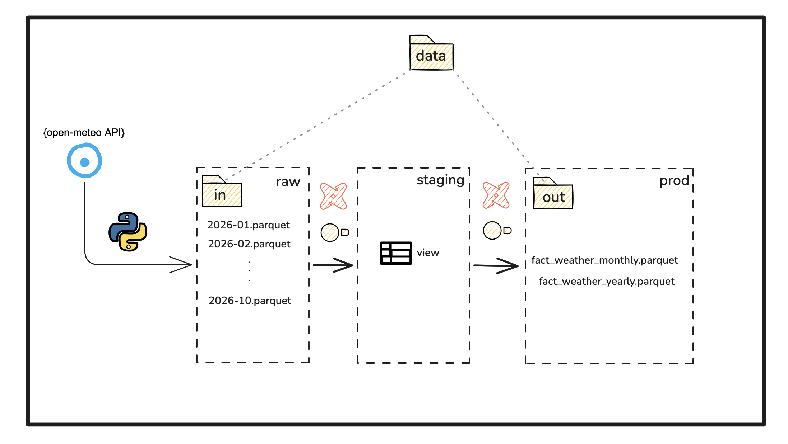

# Weather Analytics Pipeline

Daily weather for five Swedish cities (Göteborg, Örebro, Stockholm, Malmö, Uppsala), aggregated to
monthly and yearly figures.

## Overview




**Why save the API data as files?**

dbt can be re-run without calling the API again. There's one file per city and month, so fetching
a month again just overwrites that file, and the DuckDB database can always be rebuilt from `data/raw`.

**Why are the staging models views?**

Staging only renames columns and converts units, so there's no need to store a copy. A view always
reads the current files in `data/raw`.

**How is SQL executed?**

Two tools are used:

- **dbt**: turns SQL files into tables and views, in the right order
  - models: one `select` per file, in `staging/` and `prod/`
  - tests: checks on the data (unique ids, not null, monthly vs yearly totals)
- **DuckDB**: an analytical database that runs in-process (no server)

Since DuckDB reads and writes parquet natively, staging can query `data/raw` directly, and the staging and
prod models are written straight to `data/stg` and `data/prod` as parquet.

## Tools

| Step | Tool | What it does |
|---|---|---|
| Ingest | Dagster, polars, pandera | Fetches daily weather from the free [Open-Meteo archive API](https://open-meteo.com/) (no API key), validates it, and writes one parquet file per city per month |
| Transform | dbt + DuckDB (`dbt-duckdb`) | Loads the parquet files into a local DuckDB database, joins them with city data from a seed, and builds monthly and yearly tables that are exported to parquet |
| Viz | marimo, Altair | Notebook with a sunshine-per-city donut chart, a temperature range chart that adds city attributes (latitude, coastal or inland), and a monthly rain line chart, read from the exported parquet files |

## Run it locally

Prerequisites: [uv](https://docs.astral.sh/uv/) and `make`. uv installs the right Python (3.12) and
all dependencies on first use.

```bash
git clone <repo-url> && cd dbt-de-weather

make ingest      # 1. fetch this year's weather up to today  -> data/raw/
make transform   # 2. build and test the dbt models          -> weather.duckdb, data/stg/, data/prod/
make viz         # 3. open the notebook as an app             -> http://localhost:2718
make docs        # optional: browse the dbt docs and lineage  -> http://localhost:8080
```

In the Dagster UI, open the `weather` asset group, select all assets and click **Materialize**,
choosing the months to fetch (e.g. 2025-01 up to the current month). That one run
fetches the weather into `data/raw/` (one partition per month from 2024, each fetching every city), builds and tests
the dbt models (`weather.duckdb`, `data/stg/`, `data/prod/`) and exports the notebook as a static HTML report to
`data/report/weather.html` (latest year, no code). The `weather_monthly` job does the same for last
month; its schedule (the 2nd of each month) is off until you switch it on.

Both `make` targets install the dbt packages (`dbt_utils`) the first time they run.

### Options

```bash
make transform ARGS="--full-refresh"     # rebuild everything, e.g. after changing the seed's columns
make transform ARGS="-s fct_weather_monthly"
```

`make transform` runs dbt without Dagster, on whatever is in `data/raw/`. Re-materializing a
partition overwrites its file; the next dbt build picks up only the new rows. To edit the notebook instead of viewing it: `uv run marimo edit notebooks/weather.py`.

## Repository structure

```
├── orchestrator/                # Dagster: ingestion (Open-Meteo -> data/raw), dbt, report, job
├── dbt/                         # dbt project (dbt runs from this folder, see Makefile)
│   ├── seeds/cities.csv         # cities with coordinates and attributes; also read by ingestion
│   ├── models/
│   │   ├── staging/             # stg_weather_daily (reads data/raw), stg_cities: renaming, unit conversion, ids -> data/stg/*.parquet
│   │   └── prod/                # fct_weather_monthly, fct_weather_yearly -> data/prod/*.parquet
│   ├── tests/                   # custom data tests (monthly vs yearly reconciliation)
│   ├── macros/                  # schema naming (seeds / staging / prod), per-folder external_root
│   ├── profiles.yml             # DuckDB connection: $WEATHER_DB_PATH (.env), default ../weather.duckdb
│   └── packages.yml             # dbt_utils
├── notebooks/weather.py         # marimo notebook
├── data/
│   ├── raw/                     # ingested parquet (not committed)
│   ├── stg/                     # exported staging tables (not committed)
│   ├── prod/                    # exported prod tables (not committed)
│   └── report/                  # notebook exported as HTML by Dagster (not committed)
├── Makefile                     # orchestrate / transform / viz
└── pyproject.toml               # dependencies, ruff config
```

## Data model

Every table has an `id` (surrogate key of its grain) and is covered by dbt tests; `make transform`
also runs unit tests on the prod models before building them.

| Schema | Model | Grain |
|---|---|---|
| seeds | `cities` | city |
| staging | `stg_cities`, `stg_weather_daily` | city / city × day |
| prod | `fct_weather_monthly` | city × month |
| prod | `fct_weather_yearly` | city × year |

To add a city, add a row (with latitude and longitude) to `dbt/seeds/cities.csv`, re-materialize
the months in Dagster, run `make transform ARGS="--full-refresh"`, and give it a colour in `CITY_COLORS` in the notebook.
